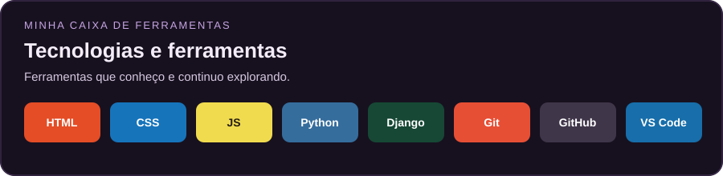
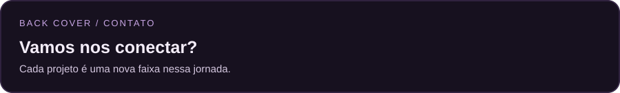

  

  

## 💿 Lado A — projetos em destaque

## 📼 Lado B — estudos e experimentos

🎧 Notas sobre os projetos

- **AmbiDiff:** desenvolvido com apoio de IA, é também meu laboratório para aprender a compreender e manter projetos em Python.
- **VibeFlix:** uma landing page que inspira meus estudos sobre catálogos e recomendações.
- **Mural de Pensamentos:** projeto educacional para cadastrar, listar, editar e excluir pensamentos.
- **CodeConnect e Catálogo de Livros:** experimentos para praticar JavaScript e manipulação do DOM.

## 📊 Disco em números — estatísticas do GitHub

  
  
  

---

Arte da capa adaptada do template <a href="https://github.com/beydemirfurkan/awesome-github-profile/tree/main/templates/10-print-analog/vinyl-sleeve">Vinyl Sleeve</a>.
